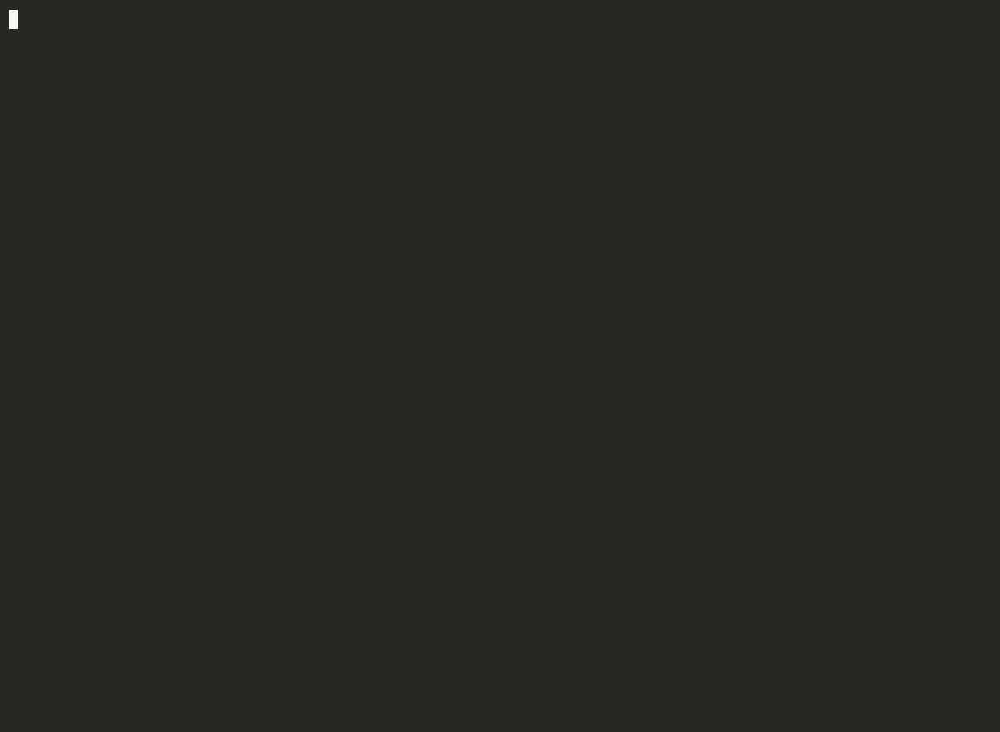

# lockrot

[](https://github.com/somework/lockrot/actions/workflows/ci.yml)
[](https://packagist.org/packages/somework/lockrot)
[](https://packagist.org/packages/somework/lockrot)
[](https://github.com/somework/lockrot/releases/latest)
[](LICENSE)

**lockrot finds the packages in `composer.lock` that nobody maintains, including the ones
that `composer audit` passes because no maintainer marked them abandoned.**

Each finding carries its evidence and the dependency chain that pulled it in. lockrot reads
`composer.lock` and `composer.json` and writes neither.

```bash
composer require --dev somework/lockrot
composer config allow-plugins.somework/lockrot true
composer lockrot
```

[See a full recorded run on a real project's lock →](https://lockrot.dev/example-run/)

## Contents

[Install](#install) · [First run](#first-run) · [What it reports](#what-it-reports) ·
[In CI](#in-ci) · [Not every finding is a problem](#not-every-finding-is-a-problem) ·
[Configuration](#configuration) · [Documentation](#documentation) · [Limitations](#limitations) ·
[Roadmap](#roadmap) · [Contributing](#contributing) · [Security](#security) · [License](#license)

## Install

The Composer plugin needs PHP 7.4+ and Composer 2.2+ and adds `composer lockrot` (alias
`composer rot`):

```bash
composer require --dev somework/lockrot
composer config allow-plugins.somework/lockrot true
```

The `composer config` line grants the plugin the permission that Composer asks for.

The plugin also prints a short summary of the graded packages that a `composer require`, `update`
or `install` changes. To silence it, set `extra.lockrot.install-time` to `off`
([Install-time summary](https://lockrot.dev/install-time/)).

The standalone PHAR needs only PHP 7.4+ and adds nothing to your project:

```bash
curl -fsSL -o lockrot.phar https://lockrot.dev/lockrot.phar
php lockrot.phar -d /path/to/project
```

- **Verify the download:** `phive install somework/lockrot` downloads the PHAR and checks its GPG
  signature in one step. The sha256, GPG and build-attestation checks by hand are in
  [Verifying the download](https://lockrot.dev/phar/#verifying-the-download).
- **Update it:** `php lockrot.phar self-update`
  ([Keeping it updated](https://lockrot.dev/phar/#keeping-it-updated)).

## First run

Goal: see what in your lock is unmaintained, why, and how to act on it. You need the plugin
installed and, for a complete run, a GitHub token in `GITHUB_TOKEN`
([Repository hosts and credentials](https://lockrot.dev/internals/#repository-hosts-and-credentials)).

1. Run it:

    ```bash
    composer lockrot
    ```

    lockrot checks against `config.platform.php`, else the PHP that runs Composer. If your project
    runs on another PHP in production, pass `--target-php=<version>`.

    lockrot groups graded findings by grade. Each finding gives the package, how the project
    reaches it (`direct` or `via …`), its flags, the score line, the move (`do:`) and the evidence.
    The summary block under the list counts the findings per grade and per flag, sums the
    [libyears](https://lockrot.dev/verdicts/#libyears), and names the direct requirements that pull
    in the most graded packages.

    

2. Ask why one package is graded, or why it is not:

    ```bash
    composer lockrot --explain=vendor/package
    ```

    lockrot prints the package's flags, each term of its score and every signal with its dates
    ([Explaining one package](https://lockrot.dev/configuration/#explaining-one-package)).

3. Accept the current findings with the options that your CI step uses:

    ```bash
    composer lockrot --generate-baseline
    ```

    Commit the `lockrot-baseline.json` that it writes. Later runs fail only on findings that are new
    or worse ([Baseline](https://lockrot.dev/baseline/)).

4. Fail the build on the findings that matter to you:

    ```bash
    composer lockrot --fail-on=high
    ```

    lockrot exits `1` when a finding grades `high` or `critical`. For a package that the baseline
    records, only the facts that are new to the baseline count
    ([Baseline](https://lockrot.dev/baseline/)). [In CI](https://lockrot.dev/ci/) says when to pick
    another value.

Next: [What it reports](https://lockrot.dev/verdicts/) for each flag and the score,
[every configuration key](https://lockrot.dev/configuration/), and [CI setup](https://lockrot.dev/ci/).

## What it reports

Each package gets the flags that fired on it:

| Flag | Meaning |
|---|---|
| `abandoned` | Its Composer repository marks it abandoned, or its repository is archived on its host |
| `silent` | No release and no push to its repository in years |
| `pinned` | Installed from a branch snapshot (`dev-main` or any other `dev-*` branch, `2.x-dev`), or the package has no tagged release |
| `left-behind` | The installed release branch stopped releasing while a newer branch still releases |
| `old-promise` | Released before the target PHP major existed, and admits it only because `require.php` has no upper bound |
| `stale` | An old release or an old push, short of `silent` |
| `capped` | The installed release's `require.php` stops below the newest PHP that the project allows |
| `vulnerable` | A security advisory affects the installed version |

- **Score and verdict:** the flags add up to a score, and the score's band is the finding's grade,
  `critical` to `low`. A transitive or development-only package scores lower. A finding with score
  0 reads `unknown`, `finished` or `ok` ([The score](https://lockrot.dev/verdicts/#score)).
- **Security advisories:** lockrot reads the advisories that `composer audit` reports, names the
  release that fixes each one and what holds that release back. An advisory that no reachable
  release fixes counts double
  ([Security advisories](https://lockrot.dev/verdicts/#security-advisories)).
- **Transitive exposure:** a transitive finding names every direct requirement that reaches it, and
  each direct requirement's evidence lists the graded packages it pulls in
  ([Transitive exposure](https://lockrot.dev/verdicts/#transitive-exposure)).
- **Libyears:** the summary's `libyears:` line sums, over the lock, the years between each
  installed release and the package's newest release
  ([Libyears](https://lockrot.dev/verdicts/#libyears)).

[What it reports: every flag, signal and score rule →](https://lockrot.dev/verdicts/)

## In CI

Run the same command as a CI step, with `GITHUB_TOKEN` in the step's environment:

```yaml
- name: lockrot
  run: composer lockrot --fail-on=high --target-php=8.4
  env:
    GITHUB_TOKEN: ${{ secrets.GITHUB_TOKEN }}
```

- **`--fail-on`** takes a grade (how much a finding matters here), a flag (one fact that lockrot
  observed), a `vulnerable` value (an advisory of that severity or worse) or `unchecked` (a check
  could not run).
- **Exit codes:** `0` passed, `1` a finding reached `--fail-on` (or, with `--strict-network`, a
  network lookup failed), `2` lockrot could not run or finish
  ([Exit codes](https://lockrot.dev/ci/#exit-codes)).
- **Formats:** `--format` takes `table` (default), `json`, `github` (annotations), `sarif` (code
  scanning), `gitlab` (Code Quality), `markdown` (PR comment) or `html` (one self-contained page).
  Each `--output=<format>:<path>` writes one more from the same run
  ([Writing reports to files](https://lockrot.dev/configuration/#writing-reports-to-files)).

Choosing a threshold and what each format gives: [In CI](https://lockrot.dev/ci/).

On GitHub Actions, [somework/lockrot-action](https://github.com/somework/lockrot-action) v1 runs
lockrot in one step:

```yaml
- uses: somework/lockrot-action@v1
  with:
    target-php: '8.4'
    fail-on: high
```

On other CI systems, use the PHAR or the Docker image `ghcr.io/somework/lockrot`
([The Docker image](https://lockrot.dev/phar/#the-docker-image)).

## Not every finding is a problem

- **Baseline:** accept findings with `--generate-baseline`
  ([Baseline](https://lockrot.dev/baseline/)).
- **Allowlist:** packages on the built-in allowlist (`psr/*`, `symfony/polyfill-*` and others)
  report as `finished`. Add your own under `extra.lockrot.ignore`, each with a `package` and a
  `reason` ([The allowlist](https://lockrot.dev/configuration/#the-allowlist)).

## Configuration

Settings live under `extra.lockrot` in `composer.json`. A CLI option wins over an environment
variable, which wins over `composer.json`. The keys that most projects set:

| `extra.lockrot` key | CLI option | Default | Effect |
|---|---|---|---|
| `fail-on` | `--fail-on` | `none` | The values that exit `1`: a grade, a flag, a `vulnerable` value, `unchecked`, or `none` |
| `target-php` | `--target-php` | `config.platform.php`, else the running PHP | The PHP version that the project runs on: decides `old-promise`, and the newer branch that a `left-behind` finding names |
| `include-dev` | `--dev` | `false` | Also check `packages-dev` |
| `format` | `--format` | `table` | Output format |
| `ignore` | — | `[]` | Project allowlist |

A key that lockrot does not know gets one warning line on stderr and changes nothing
([Unknown keys](https://lockrot.dev/configuration/#unknown-keys)).

[Every key, environment variable and option →](https://lockrot.dev/configuration/)

## Documentation

The full documentation is at [lockrot.dev](https://lockrot.dev).
What changed in each release is in the [changelog](https://lockrot.dev/changelog/).

## Limitations

- **Hosts:** repository activity comes from GitHub, GitLab (gitlab.com and `gitlab-domains`) and
  Bitbucket Cloud only. GitLab's archived flag needs a token
  ([Repository hosts and credentials](https://lockrot.dev/internals/#repository-hosts-and-credentials)).
- **Anonymous caps:** without credentials for GitHub or Bitbucket, lockrot asks the host only about
  packages that are already stale on release age, up to a per-run cap. The report counts what
  lockrot skipped
  ([Repository hosts and credentials](https://lockrot.dev/internals/#repository-hosts-and-credentials)).
- **Package metadata** comes from the Composer repositories that your project configures. A Satis
  build needs `notify-batch` set
  ([Which Composer repository answers](https://lockrot.dev/internals/#two-passes)).
- **No inherited flags:** a package never gets a flag for what it depends on. Its evidence and the
  `pulled in by:` line say what it pulls in
  ([Transitive exposure](https://lockrot.dev/verdicts/#transitive-exposure)).
- **`composer require --dev … --dry-run`:** the install-time summary can read a new package's
  grade one band high
  ([Under `--dry-run`](https://lockrot.dev/install-time/#a-note-on-the-dry-run-development-flag)).

## Roadmap

Planned and proposed work is tracked as
[enhancement issues](https://github.com/somework/lockrot/issues?q=is%3Aissue+label%3Aenhancement).

## Contributing

We welcome bug reports, fixes and additions to the built-in allowlist
([`CONTRIBUTING.md`](CONTRIBUTING.md)). What counts as public interface, and the stability promise
for reports and options: [Compatibility](https://lockrot.dev/compatibility/).

## Security

To report a security issue, follow [`SECURITY.md`](SECURITY.md). Do not open a public issue.
What lockrot reads, writes and contacts is in
[What lockrot does and does not do](SECURITY.md#what-lockrot-does-and-does-not-do).

## License

MIT ([`LICENSE`](LICENSE)). Written by Igor Pinchuk.
